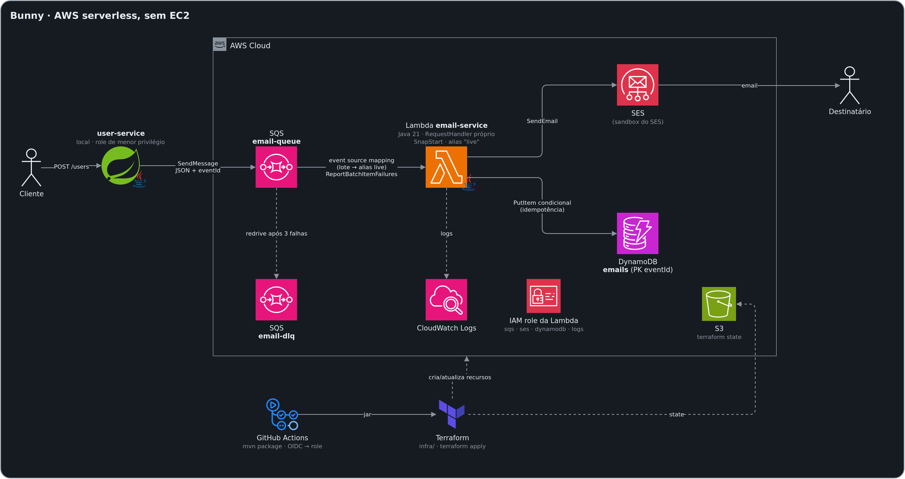

# Bunny       

Microsserviços orientados a eventos em Spring Boot, **serverless na AWS** (SQS, Lambda com SnapStart, SES e DynamoDB), com toda a infraestrutura em **Terraform** e deploy pelo **GitHub Actions via OIDC**, sem nenhuma chave de acesso guardada em lugar nenhum.

Quando um usuário se cadastra, o `user-service` publica um evento. O `email-service`, uma Lambda, consome o evento, envia o email de boas-vindas pelo SES e registra o resultado no DynamoDB, garantindo que **cada evento gera no máximo um email** mesmo com entregas repetidas.

---

## Por que este projeto existe

O objetivo foi praticar, ponta a ponta, os problemas que aparecem em sistemas distribuídos de verdade, e não só um CRUD:

- **Entrega "pelo menos uma vez".** Filas reentregam mensagens. Como não enviar o mesmo email duas vezes?
- **Falhas parciais.** Num lote de 10 mensagens, uma falha não pode derrubar as outras 9.
- **Mensagens venenosas.** O que acontece com uma mensagem que nunca vai dar certo?
- **Cold start do Java em Lambda.** Spring Boot em Lambda é viável?
- **Custo.** Quanto custa deixar isso no ar com pouco tráfego?
- **Segurança.** Menor privilégio para cada peça e CI sem segredo de longa duração.
- **Regra de negócio isolada da infraestrutura.** O handler da Lambda é só uma porta de entrada: o `EmailService` não conhece SQS nem Lambda.

---

## Arquitetura



**O fluxo:**
1. `POST /users` grava o usuário no DynamoDB numa transação que também garante que o email é único.
2. O `user-service` publica `{eventId, ownerRef, to, subject, body}` na `email-queue`.
3. O SQS aciona a Lambda pelo alias `live` em lotes de até 10 mensagens.
4. Para cada mensagem, a Lambda **reserva** o `eventId` no DynamoDB (`PENDING`), envia pelo SES e grava `SENT` ou `FAILED`.
5. Só as mensagens que falharam voltam para a fila. Depois de 3 recepções, o SQS move a mensagem para a `email-dlq`.

---

## Stack

| | Camada | Tecnologia |
|:-:|---|---|
|  | Linguagem | Java 21 |
|  | Framework | Spring Boot 4.1 (Web MVC, Validation), Jackson 3 |
|  | Mensageria | Amazon SQS + dead-letter queue |
|  | Compute | AWS Lambda (`java21`, 1024 MB, SnapStart, alias `live`) |
|  | Banco | DynamoDB on-demand com AWS SDK v2 **Enhanced Client** (sem Spring Data/JPA), PITR e proteção contra delete |
|  | Email | Amazon SES (API v2, `SesV2Client`) |
|  | Infra como código | Terraform (provider AWS 6.x), state no S3 com lock nativo (`use_lockfile`) |
|  | CI/CD | GitHub Actions + OIDC (sem access key) |
|  | Local | Docker Compose com DynamoDB Local |
|  | Testes | JUnit 5, Mockito, MockMvc, DynamoDB Local |
|  | Build | Maven (um projeto por serviço), zip da Lambda com `maven-assembly-plugin` |

---|---|
| Linguagem | Java 21 |
| Framework | Spring Boot 4.1 (Web MVC, Validation), Jackson 3 |
| Mensageria | Amazon SQS + dead-letter queue |
| Compute | AWS Lambda (`java21`, 1024 MB, SnapStart, alias `live`) |
| Banco | DynamoDB on-demand com AWS SDK v2 **Enhanced Client** (sem Spring Data/JPA), PITR e proteção contra delete |
| Email | Amazon SES (API v2, `SesV2Client`) |
| Infra como código | Terraform (provider AWS 6.x), state no S3 com lock nativo (`use_lockfile`) |
| CI/CD | GitHub Actions + OIDC (sem access key) |
| Local | Docker Compose com DynamoDB Local |
| Testes | JUnit 5, Mockito, MockMvc, DynamoDB Local |

---

## Decisões de projeto

### Confiabilidade

**Idempotência pelo `eventId`.** O SQS entrega *pelo menos uma vez*. O `eventId` é gerado pelo **produtor** e é a chave da tabela `emails`. Antes de enviar, a Lambda grava o evento com a condição `attribute_not_exists(id) OR statusEmail = FAILED`. Uma entrega repetida de algo já `SENT` (ou em envio) é ignorada, e uma que falhou antes pode tentar de novo.

**Falha parcial de lote.** O `SqsConsumer` devolve um `SQSBatchResponse` só com as mensagens que falharam (`ReportBatchItemFailures`). Sem isso, uma mensagem ruim faria o lote inteiro ser reprocessado, e o SQS reenviaria emails que já tinham saído.

**DLQ com o ciclo fechado.** Falhou no SES → status `FAILED` → a exceção sobe → a mensagem volta para a fila → depois de `maxReceiveCount = 3` vai para a `email-dlq`, que guarda por 14 dias. Testado com um destinatário não verificado no sandbox.

**Visibility timeout = 6 × timeout da Lambda** (180 s), a recomendação da AWS. Com um valor menor, o SQS entregaria a mesma mensagem de novo enquanto a Lambda ainda a processa. O valor é derivado no Terraform (`6 * aws_lambda_function.email.timeout`), então não fica dessincronizado.

**Concorrência limitada a 2** no event source mapping, porque o SES no sandbox aceita 1 email por segundo.

**Email único sem `UNIQUE`.** O DynamoDB não tem restrição de unicidade. O `user-service` grava o usuário e um item marcador `EMAIL#<email>` na mesma `TransactWriteItems`, os dois com `attribute_not_exists(id)`. Se o email já existe, a transação inteira é cancelada e a API responde 409. O email é normalizado (trim + minúsculas), e o delete apaga os dois itens juntos.

### Lambda com Spring Boot e SnapStart

O handler é um `RequestHandler<SQSEvent, SQSBatchResponse>` próprio que sobe o Spring com `WebApplicationType.NONE` no **construtor**. Assim o contexto inteiro entra no snapshot do SnapStart: a AWS roda o init uma vez quando publica a versão e, nos cold starts, só restaura a memória.

| | Sem SnapStart | Com SnapStart |
|---|---|---|
| Inicialização | 4266 ms (Init Duration) | **805 ms** (Restore Duration) |
| Duração cobrada no cold start | 4285 ms | **337 ms** |

Para isso funcionar, nenhum UUID ou timestamp é gerado em campo estático ou no init. Senão, todas as instâncias restauradas compartilhariam o mesmo valor.

O SQS chama sempre o alias `live`, nunca a função direto: o SnapStart só existe em versões publicadas. A cada deploy, o Terraform publica uma versão nova e move o alias para ela.

### Segurança

- **Uma role por peça, com menor privilégio.**
  - Lambda: `ReceiveMessage`/`DeleteMessage` só na `email-queue`, `PutItem`/`GetItem` só na tabela `emails`, `SendEmail` só na identidade do remetente.
  - `user-service`: `SendMessage` na fila e as 4 operações que ele usa na tabela `users`. Rodando local, ele **assume** essa role por um profile da AWS em vez de usar a credencial de admin de quem está desenvolvendo.
- **CI sem segredo.** O GitHub Actions troca o token OIDC do job por uma credencial temporária. A role de deploy só aceita tokens de push na `main` deste repositório.
- **Nenhum segredo no código.** `application.yaml` só tem `${ENV_VAR}`. O `terraform.tfvars` e o `.env` ficam fora do git.

### Custo (FinOps)

DynamoDB em vez de banco relacional foi uma decisão de custo. Na AWS, um RDS fica ligado 24 h e obriga a Lambda a rodar numa VPC com NAT Gateway, cerca de US$ 32/mês só o NAT. Estimativas para pouco tráfego em us-east-1:

| Arquitetura | Custo mensal aproximado |
|---|---|
| **Lambda + SQS + DynamoDB on-demand (esta)** | **~US$ 0–1**, dentro da cota gratuita |
| Lambda + RDS | ~US$ 15–50+ |
| Fargate + RDS | ~US$ 40+ |

Pelo mesmo motivo, a fila é SQS e não um broker como RabbitMQ: a Lambda não é acionada por broker externo, e manter um consumidor ligado 24 h deixaria de ser serverless.

### Código desacoplado

- **Handler fino.** O `SqsConsumer` só desserializa e chama `EmailService.send(dto)`. Trocar a origem dos eventos não mexe na regra de negócio.
- **Contrato em JSON puro**, sem serialização Java nem headers de framework: qualquer produtor que escreva o JSON funciona.

---

## API (`user-service`, porta 8081)

| Método | Rota | Resposta |
|---|---|---|
| `POST` | `/users` | **201** usuário criado e evento publicado · **400** dados inválidos (com os campos) · **409** email já cadastrado |
| `GET` | `/users` | **200** lista de usuários |
| `DELETE` | `/users/{id}` | **204** apagado · **404** não existe · **400** id não é UUID |

```json
{
  "status": 400,
  "detail": "Dados inválidos.",
  "errors": { "email": "deve ser um endereço de e-mail bem formado" }
}
```

### Contrato da mensagem (`email-queue`)

```json
{
  "eventId": "7b6792cc-2b70-4f96-9570-eb17f20a5397",
  "ownerRef": "06a7afc6-7cea-4f25-bf16-8b17f44d1590",
  "to": "fulano@exemplo.com",
  "subject": "Bem-vindo ao nosso sistema!",
  "body": "Olá Fulano, obrigado por se cadastrar em nosso sistema!"
}
```

---

## Infraestrutura (`infra/`)

| Arquivo | O que cria |
|---|---|
| `versions.tf` | provider AWS 6.x e backend S3 com lock nativo |
| `provider.tf` | região e `default_tags` aplicadas a todos os recursos |
| `sqs.tf` | `email-queue` com redrive para a `email-dlq` |
| `dynamodb.tf` | tabelas `emails` e `users` (on-demand, PITR, proteção contra delete) |
| `ses.tf` | identidade do remetente |
| `iam.tf` | roles da Lambda e do `user-service` |
| `lambda.tf` | função, SnapStart, alias `live` e event source mapping |
| `github.tf` | provedor OIDC do GitHub e role de deploy |
| `outputs.tf` | ARNs das roles, nome da tabela e URL da fila |

---

## Como rodar

### Pré-requisitos

- Java 21, Docker, Terraform ≥ 1.10 e AWS CLI v2
- Uma conta AWS com credencial de admin configurada no `~/.aws`

### 1. Infra na AWS

O state fica num bucket S3 criado antes, uma única vez (o nome está em `infra/versions.tf`).

```bash
cd email-service && ./mvnw package          # gera target/*-lambda.zip, que o Terraform publica
cd ../infra
echo 'sender_email = "seu-email@exemplo.com"' > terraform.tfvars
terraform init
terraform plan
terraform apply
```

O SES manda um email de verificação para o `sender_email`; clique no link. Enquanto a conta estiver no **sandbox do SES**, o destinatário também precisa ser uma identidade verificada.

### 2. Profile do `user-service`

Adicione ao `~/.aws/config`, usando o output `user_service_role_arn`:

```ini
[profile bunny-user-service]
role_arn = arn:aws:iam::<conta>:role/bunny-user-service
source_profile = default
region = us-east-1
```

### 3. `.env`

```bash
cp .env.example .env
```

```properties
AWS_REGION=us-east-1
DYNAMODB_ENDPOINT=http://localhost:8000     # vazio = DynamoDB da AWS
DYNAMODB_EMAIL_TABLE=emails
DYNAMODB_USER_TABLE=users
EMAIL_FROM=seu-email@exemplo.com            # o mesmo sender_email do Terraform
EMAIL_QUEUE_URL=...                         # terraform -chdir=infra output -raw email_queue_url
```

Com `DYNAMODB_ENDPOINT` preenchido, os serviços usam credenciais fictícias para o DynamoDB e criam as tabelas locais sozinhos.

### 4. Subir o `user-service`

Rode **a partir da raiz do repositório**, porque o `.env` e o `compose.yaml` são lidos com caminho relativo a ela. No IntelliJ isso já é o padrão; basta definir `AWS_PROFILE=bunny-user-service` na run configuration.

```bash
docker compose up -d
AWS_PROFILE=bunny-user-service ./user-service/mvnw -f user-service/pom.xml spring-boot:run \
  -Dspring-boot.run.workingDirectory=$PWD
```

### 5. Testar ponta a ponta

```bash
curl -X POST localhost:8081/users -H 'Content-Type: application/json' \
     -d '{"name":"Fulano","email":"um-email-verificado@exemplo.com"}'
```

Para acompanhar: os logs da Lambda em `/aws/lambda/bunny-email-service` no CloudWatch, e o status do evento na tabela `emails`.

### Deploy pelo GitHub Actions

O workflow [`.github/workflows/deploy.yml`](.github/workflows/deploy.yml) roda a cada push na `main` que mexa em `email-service/` ou `infra/`: build e testes (com DynamoDB Local como service container), depois `terraform apply`. No repositório, configure as *variables* do Actions:

| Variable | Valor |
|---|---|
| `AWS_DEPLOY_ROLE_ARN` | output `github_deploy_role_arn` |
| `SENDER_EMAIL` | o remetente verificado no SES |

---

## Testes

Com `docker compose up -d` rodando:

```bash
cd user-service && ./mvnw test
cd email-service && ./mvnw test
```

| Serviço | O que é testado |
|---|---|
| `user-service` | email único (inclusive com caixa e espaços diferentes), delete apagando o marcador e liberando o email, 404, 400 com os campos inválidos, contexto do Spring |
| `email-service` | mensagem duplicada gera um único envio, falha do SES grava `FAILED` e a retentativa envia, lote com falha parcial reporta só as mensagens certas, init da Lambda sobe o Spring sem web, repositório |

O SES é simulado com Mockito, então nenhum email de verdade sai nos testes.

---

## Estrutura

```
bunny/
├── compose.yaml                 # DynamoDB Local
├── .env.example                 # modelo de configuração (o .env real fica fora do git)
├── .github/workflows/deploy.yml # build + terraform apply via OIDC
├── infra/                       # Terraform
├── docs/                        # diagramas (.drawio + PNGs)
├── user-service/                # produtor: API REST de usuários
│   └── src/main/java/.../       controller · service · repository · producer · dto · config
└── email-service/               # consumidor: Lambda de envio de email
    ├── src/assembly/lambda.xml  # zip da Lambda: classes na raiz, dependências em lib/
    └── src/main/java/.../       consumer (SqsConsumer) · service · repository · domain · dto · config
```

---

## Limitações conhecidas

- **Escrita dupla no cadastro.** O usuário é gravado e depois o evento é publicado. Se o `SendMessage` falhar, o usuário fica salvo sem o email de boas-vindas. A correção é um *outbox*, por exemplo com DynamoDB Streams acionando a publicação.
- **`PENDING` preso.** Se a Lambda morrer entre reservar o evento e enviar, o registro fica `PENDING` e as reentregas são ignoradas. Um `PENDING` com prazo de expiração resolveria.
- **SES no sandbox.** Só envia para endereços verificados, com limite de 200 por dia.
- **Listagem sem paginação.** `GET /users` lê a tabela inteira com `Scan`.
- **Versões da Lambda acumulam** a cada deploy, e o log group não tem retenção configurada.
