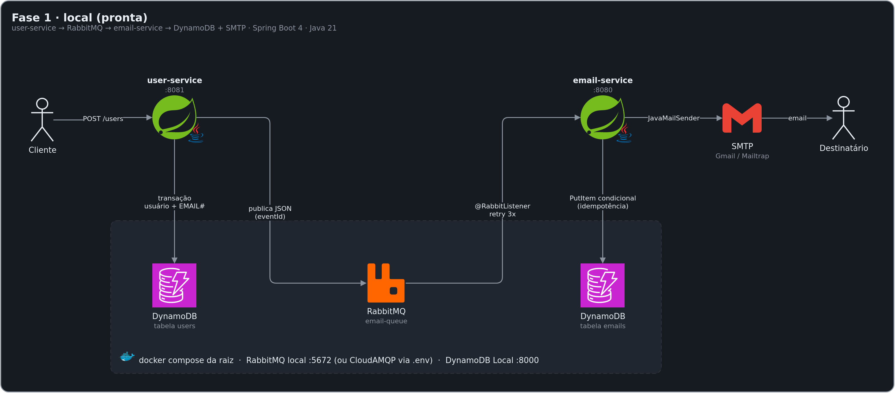
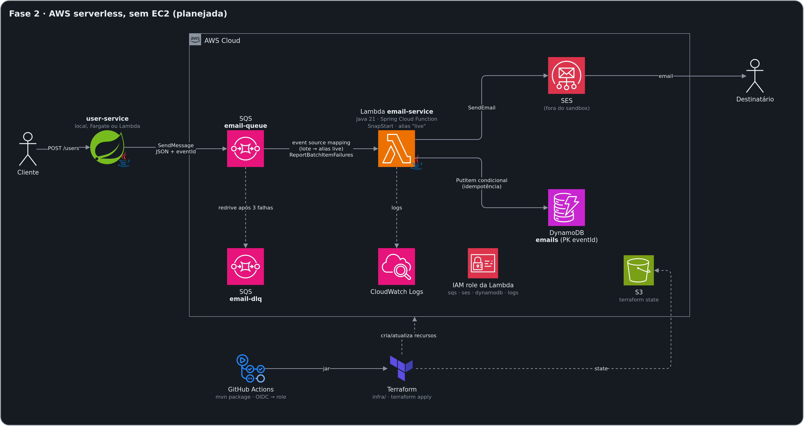

# Bunny      

Projeto de estudo de microsserviços orientados a eventos com Spring Boot. Quando um usuário se cadastra, o `user-service` publica um evento no RabbitMQ. O `email-service` consome esse evento, envia o email de boas-vindas por SMTP e registra o status no DynamoDB.

O projeto foi escrito para virar **serverless na AWS** (SQS + Lambda + SES) sem reescrever a regra de negócio. A fase 1, local, está pronta. A fase 2 está planejada.

---

## Arquitetura (fase 1)



1. O cliente cria um usuário em `POST /users`.
2. O `user-service` grava o usuário no DynamoDB numa transação que também garante que o email é único.
3. Ele publica a mensagem `{eventId, ownerRef, to, subject, body}` na fila `email-queue`.
4. O `email-service` reserva o `eventId` no DynamoDB como `PENDING`, envia o email e atualiza o status para `SENT` ou `FAILED`.
5. Se o envio falhar, a mensagem é entregue de novo até 3 vezes (com espera de 2 s, 4 s e 8 s).

Localmente, o DynamoDB Local e o RabbitMQ sobem pelo `compose.yaml` da raiz. O RabbitMQ também pode ser o CloudAMQP, configurado pelo `.env`.

### Para onde vai (fase 2)



O RabbitMQ vira SQS, o listener vira o handler da Lambda e o SMTP vira SES. O `EmailService` continua igual. Infra com Terraform e deploy pelo GitHub Actions. As imagens são exportadas do [`docs/arquitetura.drawio`](docs/arquitetura.drawio) (uma aba por fase).

---

## Stack

| Camada | Tecnologia |
|---|---|
| Linguagem | Java 21 |
| Framework | Spring Boot 4.1 (Web MVC, AMQP, Mail, Validation) |
| Mensageria | RabbitMQ 4 (local ou CloudAMQP) |
| Banco | DynamoDB com AWS SDK v2 **Enhanced Client** (sem Spring Data/JPA) |
| Email | JavaMailSender (SMTP do Gmail ou Mailtrap) |
| Infra local | Docker Compose (DynamoDB Local + RabbitMQ) |
| Testes | JUnit 5, Mockito, MockMvc, DynamoDB Local |
| Build | Maven (um projeto por serviço) |
| Fase 2 (planejada) | SQS, Lambda + SnapStart, SES, Terraform, GitHub Actions |

---

## Decisões de projeto

**Email único sem `UNIQUE`.** O DynamoDB não tem restrição de unicidade. O `user-service` grava o usuário e um item marcador `EMAIL#<email>` na mesma transação (`TransactWriteItems`), os dois com `attribute_not_exists(id)`. Se o email já existe, a transação inteira é cancelada e a API responde 409. O email é normalizado (trim + minúsculas), então `Fulano@X.com` e `fulano@x.com` colidem. O delete apaga os dois itens juntos, o que libera o email.

**Idempotência pelo `eventId`.** Filas entregam *pelo menos uma vez*, então a mesma mensagem pode chegar duas vezes. O `eventId` é gerado pelo produtor e é a chave da tabela `emails`. Antes de enviar, o `email-service` grava o evento com a condição "não existe ou falhou antes". Uma entrega repetida de algo já `SENT` (ou em envio) é ignorada e não gera email duplicado.

**Garantia de envio sem `@Transactional`.** O `@Transactional` do Spring não cobre DynamoDB nem SMTP, e um email enviado não pode ser desfeito. A garantia vem do status no banco (`PENDING` → `SENT`/`FAILED`), da retentativa do listener e da idempotência acima.

**Listener fino.** O `EmailConsumer` só recebe a mensagem e chama `EmailService.send(dto)`. Na fase 2, o handler da Lambda substitui o listener e chama o mesmo método.

**Contrato em JSON puro.** A mensagem não depende de serialização Java nem do header `__TypeId__`, porque o SQS só transporta texto. O record `SendEmailDto` é o mesmo nos dois serviços.

**DynamoDB em vez de banco relacional.** Na AWS, um RDS fica ligado 24 h e obriga a Lambda a rodar dentro de uma VPC com NAT Gateway (cerca de US$ 32/mês só o NAT). O DynamoDB sob demanda custa praticamente zero com pouco tráfego.

**Configuração só por variável de ambiente.** Nenhum segredo no `application.yaml`. Tudo vem de um único `.env` na raiz, compartilhado pelos dois serviços e pelo `compose.yaml`.

---

## API (`user-service`, porta 8081)

| Método | Rota | Resposta |
|---|---|---|
| `POST` | `/users` | **201** usuário criado e email de boas-vindas disparado · **400** dados inválidos (com o campo que falhou) · **409** email já cadastrado |
| `GET` | `/users` | **200** lista de usuários |
| `DELETE` | `/users/{id}` | **204** apagado · **404** não existe · **400** id não é UUID |

Exemplo de 400:

```json
{
  "status": 400,
  "detail": "Dados inválidos.",
  "errors": { "email": "deve ser um endereço de e-mail bem formado" }
}
```

### Contrato da mensagem (`email-queue`)

```json
{
  "eventId": "7b6792cc-2b70-4f96-9570-eb17f20a5397",
  "ownerRef": "06a7afc6-7cea-4f25-bf16-8b17f44d1590",
  "to": "fulano@exemplo.com",
  "subject": "Bem-vindo ao nosso sistema!",
  "body": "Olá Fulano, obrigado por se cadastrar em nosso sistema!"
}
```

---

## Como rodar

### Pré-requisitos

- Java 21
- Docker
- Uma conta de SMTP: Gmail com [senha de app](https://myaccount.google.com/apppasswords) (precisa da verificação em 2 etapas) ou uma inbox do [Mailtrap](https://mailtrap.io) para testes sem entregar emails de verdade

### 1. Configurar o `.env`

```bash
cp .env.example .env
```

Preencha os blocos do arquivo: RabbitMQ (local ou CloudAMQP), DynamoDB e SMTP. Para rodar tudo local:

```properties
RABBIT_HOST=localhost
RABBIT_PORT=5672
RABBIT_USER=myuser
RABBIT_PASSWORD=changeme
RABBIT_VHOST=/
RABBIT_SSL=false

AWS_REGION=us-east-1
DYNAMODB_ENDPOINT=http://localhost:8000
DYNAMODB_EMAIL_TABLE=emails
DYNAMODB_USER_TABLE=users

MAIL_HOST=smtp.gmail.com
MAIL_PORT=587
MAIL_USERNAME=seu-email@gmail.com
MAIL_PASSWORD=sua-senha-de-app
# MAIL_FROM é opcional: sem ele, o remetente é o MAIL_USERNAME
```

Com `DYNAMODB_ENDPOINT` preenchido, os serviços usam credenciais fictícias e criam as tabelas sozinhos ao subir.

### 2. Subir a infra

```bash
docker compose up -d
```

Sobe o DynamoDB Local (`:8000`) e o RabbitMQ (`:5672`). Rodando pela IDE, o Spring também sobe o compose sozinho.

### 3. Subir os serviços

Os dois serviços precisam rodar **a partir da raiz do repositório**, porque o `.env` e o `compose.yaml` são lidos com caminho relativo a ela. No IntelliJ isso já é o padrão: basta rodar `UserServiceApplication` e `EmailServiceApplication`.

Pelo terminal:

```bash
./user-service/mvnw -f user-service/pom.xml spring-boot:run -Dspring-boot.run.workingDirectory=$PWD
./email-service/mvnw -f email-service/pom.xml spring-boot:run -Dspring-boot.run.workingDirectory=$PWD
```

### 4. Testar

Crie um usuário com um endereço seu; o email de boas-vindas chega nele:

```bash
curl -X POST localhost:8081/users -H 'Content-Type: application/json' \
     -d '{"name":"Fulano","email":"seu-email@gmail.com"}'
```

---

## Testes

Com o `docker compose up -d` rodando (os testes de repositório usam o DynamoDB Local):

```bash
cd user-service && ./mvnw test
cd email-service && ./mvnw test
```

| Serviço | O que é testado |
|---|---|
| `user-service` | email único (inclusive com caixa e espaços diferentes), delete apagando o marcador e liberando o email, 404 para id inexistente, 400 com os campos inválidos, contexto do Spring |
| `email-service` | mensagem duplicada gera um único envio, falha de SMTP grava `FAILED` e a retentativa envia, repositório, contexto do Spring |

Nos testes, o SMTP é simulado com Mockito e o listener do RabbitMQ fica desligado, então nenhum email de verdade é enviado.

---

## Estrutura

```
bunny/
├── compose.yaml            # DynamoDB Local + RabbitMQ compartilhados
├── .env.example            # modelo de configuração (o .env real fica fora do git)
├── docs/
│   ├── arquitetura.drawio       # diagramas das fases 1 e 2 (editável no draw.io)
│   └── arquitetura-fase*.png    # exportados do .drawio, usados neste README
├── user-service/           # produtor: API REST de usuários
│   └── src/main/java/.../  controller · service · repository · producer · dto · dto/mapper · config
└── email-service/          # consumidor: envio de email
    └── src/main/java/.../  consumer · service · repository · domain · dto · config
```

---

## Limitações conhecidas

- **Publicação depois de salvar.** Se o RabbitMQ estiver fora do ar depois de o usuário ser gravado, o usuário fica salvo sem o email de boas-vindas e a API responde 500. A correção é um *outbox*; na fase 2, o DynamoDB Streams acionando uma Lambda faz esse papel.
- **`PENDING` preso.** Se o `email-service` cair entre reservar o evento e enviar o email, o registro fica `PENDING` e não é reenviado.
- **Sem dead-letter queue.** Depois das 3 retentativas, a mensagem é descartada e só o status `FAILED` fica no banco. Na fase 2, o SQS manda essas mensagens para uma DLQ.
- **Listagem sem paginação.** `GET /users` lê a tabela inteira com `Scan`.

## Próximos passos (fase 2)

- [x] Fase 1: user-service → RabbitMQ → email-service → DynamoDB + SMTP
- [ ] Terraform: SQS + DLQ + DynamoDB + IAM
- [ ] `email-service` como Lambda (Spring Cloud Function + SnapStart) e SMTP → SES
- [ ] `user-service` publicando no SQS
- [ ] GitHub Actions com OIDC
